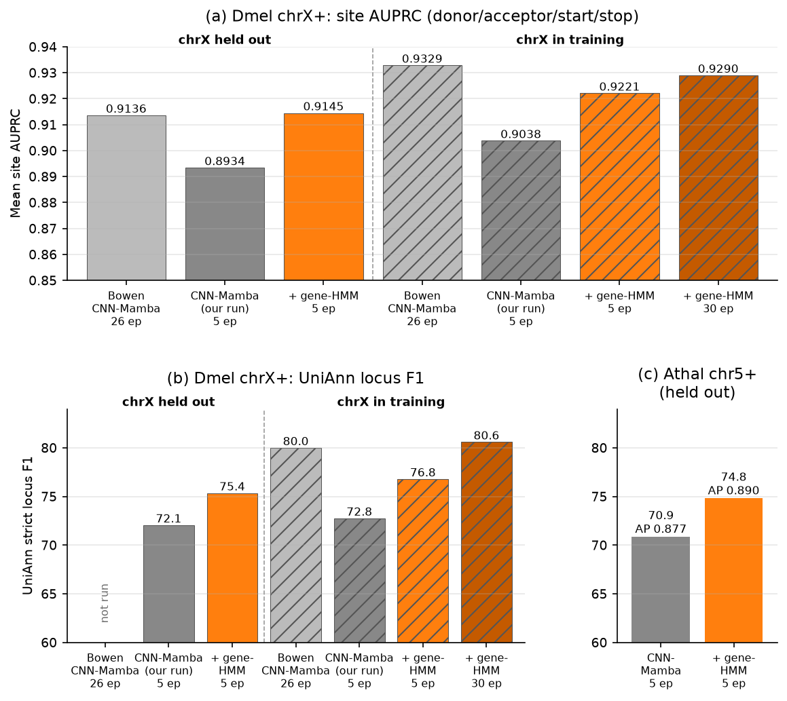
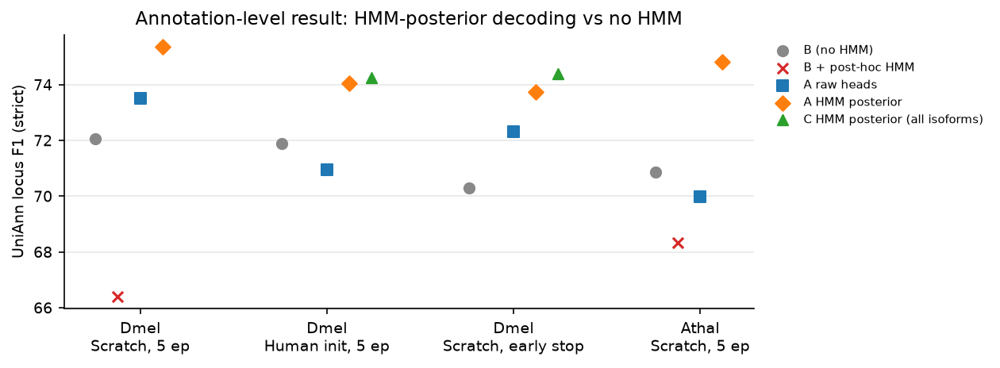
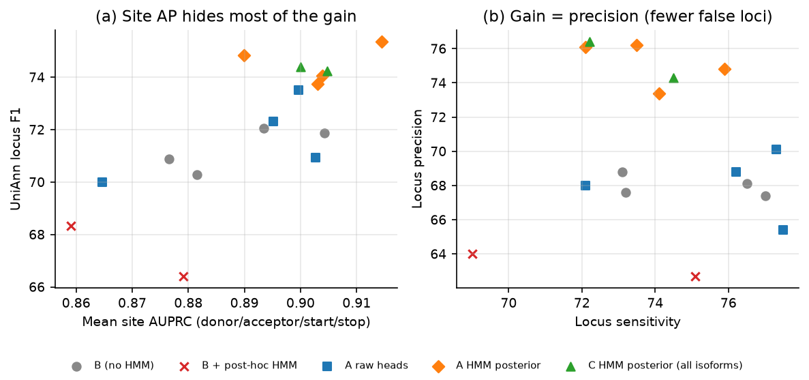
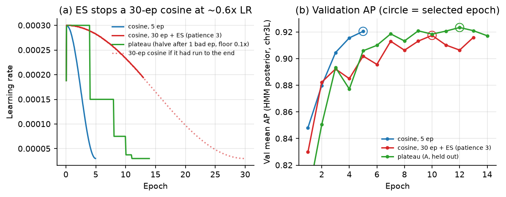
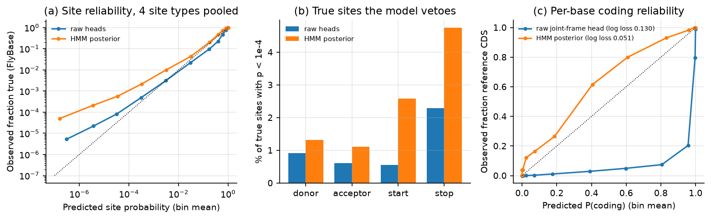

# Gene-HMM (CRF) layer for CNN-Mamba: handoff notes

Status as of 2026-10-21. Author: Hibiki (with Claude Code). Code: branch `gene-hmm-isoforms` of
<https://github.com/hibiki-kato/cnn-mamba> (a fork of `bowencccc/cnn-mamba`, branched from `main` at 809f743).

## TL;DR

- We add a small, differentiable **gene-structure CRF** on top of the existing CNN-Mamba heads and train it
  **end-to-end** with the heads. At inference, the CRF's **posterior marginals**, not the raw heads, become the
  site and per-base frame scores fed to UniAnn.
- In every setting we ran, this improves UniAnn **strict locus F1** over the same backbone without the HMM:
  - Dmel chrX+: +2.2 to +4.1.
  - Athal chr5+: +4.0 (70.9 → 74.8).
- These gains are against **our own 5-epoch baseline**, which is under-trained. Against your fully trained model
  the gain is much smaller:
  - Held-out site AUPRC is a tie (0.9145 vs 0.9136).
  - Your 80.0 locus F1 is in the chrX-in-training regime. In that regime at 5 epochs we get 72.8 without the HMM
    and 76.8 with it; trained as long as yours (30-ep cosine), the gene-HMM gets **80.6** (section 0).
    With one seed, we read this as a tie or a small gain.
  - So a large part of the +3 to +4 at 5 epochs is faster convergence. The HMM's clearest effect is on locus
    precision.
- The gain is mostly **locus precision**: the HMM model predicts fewer false loci.
  Site AUPRC barely shows it; for Athal, AUPRC rises only by +0.013.
- **End-to-end training is required.** Fitting the same CRF post hoc on a frozen baseline makes results *worse*
  in both species.
- The raw heads of the HMM-trained model are not consistently better than the baseline. The gain comes from
  **decoding through the HMM posterior**.
- Caveats are in section 6:
  - The posterior is too sure in the low tail, so it vetoes 1–5% of true sites.
  - The `pr_all.pl` converter multiplies by P(coding) twice.
  - Cosine schedule plus early stopping is a bad combination (section 5).

## 0. Headline: your CNN-Mamba vs + gene-HMM



The gene-HMM rows use the best setting: scratch, HMM loss weight 1, decoded through the HMM posterior. The
30-epoch `chrxtrain` row is the one to compare with your 80.0.
All rows use the same converter (`pr_all.pl`), the same `uniann-pr45`, and `gffcompare --strict-match -e 0`
against the same plus-strand reference.

| Model | Test chrom in training? | Epochs | Donor AP | Acceptor AP | Start AP | Stop AP | **Mean AP** | **UniAnn locus F1** (Sn / Pr) |
|---|---|---|---|---|---|---|---|---|
| **Dmel chrX+** | | | | | | | | |
| Your CNN-Mamba b010 (4-state β=0.10), `heldout` | no | 26 (ES) | 0.9570 | 0.9577 | 0.8547 | 0.8850 | 0.9136 | not run (checkpoint not here) |
| Your CNN-Mamba b010, `chrxtrain` (annotation regime) | **yes** | 26 (ES) | 0.9684 | 0.9647 | 0.8908 | 0.9075 | 0.9329 | 80.0 (80.4 / 79.6)¹ |
| Same recipe, our run (arm B) | no | 5 | 0.9478 | 0.9413 | 0.8191 | 0.8654 | 0.8934 | 72.1 (76.5 / 68.1) |
| **+ gene-HMM** (arm A, HMM posterior) | no | 5 | 0.9604 | 0.9582 | 0.8502 | 0.8894 | **0.9145** | **75.4** (75.9 / 74.8) |
| **+ gene-HMM, `chrxtrain`** (annotation regime, HMM posterior) | yes | 5 | 0.9654 | 0.9625 | 0.8625 | 0.8982 | 0.9221 | **76.8** (79.0 / 74.7) |
| same model, raw heads | yes | 5 | 0.9546 | 0.9507 | 0.8594 | 0.8992 | 0.9160 | 73.9 (78.8 / 69.6) |
| Same recipe, our run (arm B), `chrxtrain` | yes | 5 | 0.9446 | 0.9419 | 0.8389 | 0.8898 | 0.9038 | 72.8 (76.1 / 69.7) |
| **+ gene-HMM, `chrxtrain`, 30-ep cosine** (best val epoch 18, HMM posterior) | yes | 30 | 0.9696 | 0.9684 | 0.8700 | 0.9080 | 0.9290 | **80.6** (81.4 / 79.8) |
| same model, raw heads | yes | 30 | 0.9639 | 0.9624 | 0.8844 | 0.9090 | 0.9299 | 76.9 (81.0 / 73.2) |
| **Athal chr5+** | | | | | | | | |
| Same recipe (arm B) | no | 5 | 0.9510 | 0.9364 | 0.8233 | 0.7957 | 0.8766 | 70.9 (73.1 / 68.8) |
| **+ gene-HMM** (arm A, HMM posterior) | no | 5 | 0.9532 | 0.9468 | 0.8344 | 0.8254 | **0.8899** | **74.8** (73.5 / 76.2) |

¹ From `results/joint_frame_grid_v1/summary/`. Re-running your delivered scores through the corrected `pr_all.pl`
gives 79.6.

How to read this table:

- **Your UniAnn number (80.0) comes from the chrX-in-training model.** This is the intended annotation setting,
  not leakage.
  - Training never sees FlyBase. The splice/start/stop, frame and path losses all use EviAnn pseudo-labels;
    FlyBase is used only for validation AP on chr3L and for evaluation.
  - Training on the target chromosome's EviAnn labels is exactly how the model would annotate a new genome.
- **Like-for-like in the annotation regime (chrX in training, 5 epochs each):** adding the gene-HMM gives
  72.8 → 76.8 locus F1 (+4.0), again mostly from precision (69.7 → 74.7). This is the same size of gain as held-out
  Dmel (+3.3) and Athal (+4.0).
- **With matched training length the gene-HMM reaches 80.6 vs your 80.0** (30-ep cosine, no early stopping,
  best validation epoch 18).
  - The 5-epoch gap (76.8) was under-training on the training chromosomes themselves. Validation AP on chr3L
    did not move after epoch 5 (0.9235 vs 0.9234), but chrX site AP rose from 0.916 to 0.930 (raw heads) because
    chrX's EviAnn labels are in training.
  - Locus precision is the same as yours (79.8 vs 79.6); sensitivity is +1.0 (81.4 vs 80.4).
  - This is one seed. Your 80.0 is the best of five settings (74.1–80.0) picked on this test, so we read
    this as a tie or a small gain, not a clear win.
  - Decoding through the HMM posterior is still what matters: the same model's raw heads give 76.9.
  - After epoch 18 the model overfits: validation loss 0.013 → 0.025 and validation HMM AP 0.923 → 0.885 by
    epoch 30. The HMM posterior degrades faster than the raw heads.
- **Your held-out model has no UniAnn number.** It is not needed for the annotation comparison; site AUPRC is
  compared held-out.
- **Site AUPRC on held-out chrX** is a tie: 0.9145 (gene-HMM, 5 epochs) vs 0.9136 (your model, 26 epochs).
- **Our arm B is under-trained.** Our 5-epoch run of your recipe reaches only 0.8934 AP and 72.1 locus F1
  (validation AP 0.895 vs 0.919 for your run). The +3.3 (Dmel) and +4.0 (Athal) locus-F1 gains at 5 epochs are
  therefore largely faster convergence; the gene-HMM model converges in about 5 epochs on validation AP.

## 1. What we are doing

Current pipeline:

1. CNN-Mamba predicts, independently at each position, the site probabilities (donor/acceptor/start/stop)
   and the per-base joint-frame probabilities (non-CDS, frame 0/1/2).
2. UniAnn's Viterbi assembles gene models from those scores.

Problem: the heads are trained position by position. Nothing in training tells them that a donor must be
followed by an acceptor, that the frame must survive an intron, or that a stop ends the CDS. Gene-structure
consistency is enforced only at decoding time.

Idea (as in Tiberius): put a gene-structure HMM inside the network, so that training is penalised whenever the
*whole parse* is wrong, not just individual positions.

### State space (single strand, model orientation)

| State | Meaning |
|---|---|
| `IR` | intergenic / UTR / any non-coding base |
| `E0, E1, E2` | coding base at codon position 0/1/2 |
| `I0, I1, I2` | intron; `I_k` re-enters the CDS at codon position k (carries the phase across the intron) |

Allowed transitions are gated by sequence motifs. Each one is scored by the existing candidate head at that
position:

| Transition | Allowed when | Score |
|---|---|---|
| `IR → E0` (start) | ATG starts at t | start head at t |
| `E2 → IR` (stop) | stop codon at t-3..t-1 | stop head at t-3 |
| `E_k → I_{k+1}` (donor) | GT starts at t | donor head at t |
| `I_k → E_k` (acceptor) | AG at t-2..t-1 | acceptor head at t-2 |
| `E0→E1→E2→E0`, `IR→IR`, `I→I` | always (except `E2→E0` across an in-frame stop) | 0 |

- Emissions come from a new 5-class **state head** (non-CDS / frame0 / frame1 / frame2 / intron).
  The three intron states share the intron class.
- The HMM itself has only **9 learnable scalars**: a weight and a bias for each of the four boundary types, plus
  one emission weight. See section 2 for the equations.
- The transition structure is fixed. The site heads supply the position-specific transition scores.
- Code: `src/cnn_mamba/gene_hmm.py`.
  - The partition function uses a parallel tree reduction in the log semiring.
  - Posteriors are taken as the gradient of log Z with respect to the potentials (forward–backward).

### Inference

- `score_hmm_chromosome.py --score-source hmm` writes:
  - boundary-event marginals as site scores, indexed exactly like the raw heads;
  - with `--save-state-posteriors`, the per-base state posteriors `[L,7]`.
- For UniAnn, the state posteriors are collapsed to non-coding and frame k (section 2, last part).
- UniAnn (`uniann-pr45`) then decodes as before. **We do not use the CRF's own Viterbi** for gene models.

## 2. Model and loss in equations

### Notation

- One window $x_{1:L}$, with $L = 10^4$. A path $y = (y_1,\dots,y_L)$ assigns each base a state
  $y_t \in \mathcal S = \{\mathrm{IR}, E_0, E_1, E_2, I_0, I_1, I_2\}$.
- $\mathcal Y$ is the set of grammatical paths (the motif-gated transitions in section 1).
- $\mathcal Y_\ell \subseteq \mathcal Y$ is the subset compatible with the label $\ell$:
  - single path: the longest CDS of each EviAnn gene;
  - arm C: the union of isoforms, with boundary events only at annotated positions;
  - $\ell_t = -1$ (unlabelled), and the 3 bases at each window edge, allow every state.
- Network outputs at position $t$ (softmax probabilities):

  | Symbol | Head | Classes |
  |---|---|---|
  | $p^{\mathrm{st}}_t(c)$ | state head | $c \in \{\text{nc}, f_0, f_1, f_2, \text{intron}\}$ |
  | $p^{\mathrm{sp}}_t(\cdot)$ | splice head | {none, donor, acceptor} |
  | $p^{\mathrm{ss}}_t(\cdot)$ | start/stop head | {none, start, stop} |
  | $p^{\mathrm{jf}}_t(\cdot)$ | joint-frame head | {nc, $f_0$, $f_1$, $f_2$} |

### CRF potentials (9 learnable scalars $\alpha, w_b, c_b$)

Emission, where $\kappa$ maps $\mathrm{IR}\to$ nc, $E_k\to f_k$ and $I_k \to$ intron:

$$
\psi_t(s) = \alpha \,\log p^{\mathrm{st}}_t\big(\kappa(s)\big)
$$

Boundary score, $b \in \{\text{start},\text{stop},\text{donor},\text{acceptor}\}$:

$$
\phi^b_t = w_b \log p^b_t + c_b
$$

where $p^{\text{start}}_t = p^{\mathrm{ss}}_t(\text{start})$, $p^{\text{donor}}_t = p^{\mathrm{sp}}_t(\text{donor})$, and so on,
indexed by motif start.

Transition into position $t$ ($-\infty$ for every pair not listed):

$$
T_t(s', s) =
\begin{cases}
\phi^{\text{start}}_t & (\mathrm{IR}, E_0),\ \text{ATG at } t\\
\phi^{\text{stop}}_{t-3} & (E_2, \mathrm{IR}),\ \text{stop codon at } t-3..t-1\\
\phi^{\text{donor}}_t & (E_k, I_{k+1 \bmod 3}),\ \text{GT at } t \ (\text{not after an in-frame stop})\\
\phi^{\text{acceptor}}_{t-2} & (I_k, E_k),\ \text{AG at } t-2..t-1\\
0 & (\mathrm{IR},\mathrm{IR}),\ (I_k,I_k),\ (E_0,E_1),\ (E_1,E_2),\ (E_2,E_0)\ \text{unless a stop codon ends at } t-1
\end{cases}
$$

Path score and partition functions:

$$
S(y) = \sum_{t=1}^{L} \psi_t(y_t) + \sum_{t=2}^{L} T_t(y_{t-1}, y_t),
\qquad
Z = \sum_{y\in\mathcal Y} e^{S(y)},
\qquad
Z_\ell = \sum_{y\in\mathcal Y_\ell} e^{S(y)}
$$

Both sums are computed exactly by a tree reduction of $\prod_t M_t$, where
$M_t(s', s) = T_t(s', s) + \psi_t(s)$, in the $(\mathrm{logsumexp}, +)$ semiring.

### Loss

CRF term (per-base NLL of the label-constrained path set):

$$
\mathcal L_{\mathrm{CRF}} = \frac{1}{L}\big(\log Z - \log Z_\ell\big)
= -\frac{1}{L}\log P\big(y \in \mathcal Y_\ell \mid x\big)
$$

Total loss, with $\lambda = 1$ for arms A and C and $\lambda = 0$ for B:

$$
\mathcal L = 0.25\,\mathcal L_{\mathrm{splice}} + \mathcal L_{\mathrm{ss}} + 0.1\,\mathcal L_{\mathrm{jf}} + \lambda\,\mathcal L_{\mathrm{CRF}}
$$

Per-position terms. $\mathcal C$ is the set of motif candidates (GT/AG, or ATG/stop) plus every labelled positive;
$\mathcal C^{\mathrm{cds}}$ is the set of CDS bases with a known phase; $\mathcal N$ is the set of non-CDS bases.

$$
\mathcal L_{\mathrm{splice}} = \frac{1}{|\mathcal C|}\sum_{t\in\mathcal C} -\log p^{\mathrm{sp}}_t(z_t),
\qquad
\mathcal L_{\mathrm{jf}} = \frac{1}{|\mathcal C^{\mathrm{cds}}|}\sum_{t\in\mathcal C^{\mathrm{cds}}} -\log p^{\mathrm{jf}}_t(f_{\phi_t})
+ 0.1\,\frac{1}{|\mathcal N|}\sum_{t\in\mathcal N} -\log p^{\mathrm{jf}}_t(\mathrm{nc})
$$

$\mathcal L_{\mathrm{ss}}$ has the same form as $\mathcal L_{\mathrm{splice}}$, with the start/stop head.

### Why this loss: its gradient

Write $\gamma_t(s) = P(y_t = s \mid x)$ for the unconstrained posterior and
$\gamma^\ell_t(s) = P(y_t = s \mid x, y \in \mathcal Y_\ell)$ for the label-constrained one. Then

$$
\frac{\partial \mathcal L_{\mathrm{CRF}}}{\partial \psi_t(s)} = \frac{1}{L}\Big(\gamma_t(s) - \gamma^\ell_t(s)\Big),
\qquad
\frac{\partial \mathcal L_{\mathrm{CRF}}}{\partial \phi^b_t} = \frac{1}{L}\Big(\epsilon^b_t - \epsilon^{b,\ell}_t\Big)
$$

Here $\epsilon^b_t = P(\text{event } b \text{ at } t \mid x)$ is the boundary-event posterior, and $\epsilon^{b,\ell}_t$ is the same under the label constraint.

What this means:

- **Sequence-level normalisation.** The gradient is non-zero only where the model's *gene-parse* posterior
  disagrees with the label. A false GT that no competing parse uses gets no gradient. A false GT that produces a
  wrong gene model gets pushed down. Per-position cross-entropy treats every candidate independently.
- **Sum, not max.** Where $\ell_t = -1$, $\gamma^\ell_t$ is itself a posterior, so ambiguous bases are
  marginalised instead of forced. The training objective uses exactly the quantities we decode with:
  $\gamma$ and $\epsilon$.
- **Keep the per-position CE.** The CRF only sees motif-gated candidates, so the heads still need direct
  supervision. Keeping it also allows a raw-heads vs HMM-posterior comparison inside one model.
- **Few HMM parameters.** All position-specific evidence comes from the network, and the HMM only learns
  $\alpha, w_b, c_b$. It cannot memorise a genome-specific transition matrix.
- **Longest-CDS labels by default.** One grammatical path per gene is unambiguous. The all-isoform
  $\mathcal Y_\ell$ (arm C) is the principled extension; so far it is about equal (74.2–74.4 vs 73.8–74.1 locus F1).

### Inference: posteriors and the UniAnn inputs

Posteriors are obtained as gradients of $\log Z$ (equivalent to forward–backward):

$$
\gamma_t(s) = \frac{\partial \log Z}{\partial \psi_t(s)},
\qquad
\epsilon^b_t = \frac{\partial \log Z}{\partial \phi^b_t}
$$

Inputs handed to UniAnn:

- site probability at a candidate $t$: $\epsilon^b_t$ (HMM arm) or $p^b_t$ (raw arm);
- per-base frame: $p^{\mathrm{nc}}_t = \gamma_t(\mathrm{IR}) + \sum_k \gamma_t(I_k)$ and $p^{f_k}_t = \gamma_t(E_k)$;
  the raw arm uses $p^{\mathrm{jf}}_t$ instead.

UniAnn scores, from `prepare_sites.pl` and `pr_all.pl`:

$$
\text{site}_t = \Big\lfloor \tfrac{1000}{\max_t \ln(e\,p^{\text{donor}}_t)} + \tfrac12 \Big\rfloor \cdot \ln\!\big(e\,p^b_t + 10^{-10}\big)
\;\approx\; 1000\,(1 + \ln p^b_t)
$$

$$
\text{nc}_t = \ln\!\big(e\,p^{\mathrm{nc}}_t + 10^{-10}\big),
\qquad
\text{frame}_{k,t} = \ln\!\big(e\,p^{f_k}_t\,(1 - p^{\mathrm{nc}}_t) + 10^{-10}\big)
$$

## 3. How this differs from other tools

Other tools' details below are from memory; please check them against the papers before citing.

| | This work | Tiberius | Helixer + HelixerPost | AUGUSTUS | UniAnn (current pipeline) |
|---|---|---|---|---|---|
| NN | CNN-Mamba site + state heads | CNN + LSTM | CNN/BiLSTM per-base classes | none | none (consumes our scores) |
| HMM states | 7 (IR, E0–2, I0–2), single strand | ~15, explicit boundary states, both strands | HMM over base classes | generalized HMM with length distributions | own gene grammar |
| Transitions | position-dependent, from NN site heads, motif-gated | learned global matrix | fixed/heuristic | trained by counting | site scores from input files |
| HMM trained? | yes, end-to-end with the NN (9 scalars) | yes, end-to-end | no (post hoc) | yes, standalone | no |
| Training loss | CRF NLL of the label-constrained path set + per-position CE | loss on HMM-layer outputs vs labels | per-base CE only | ML counts | – |
| Decoding | posterior marginals → UniAnn Viterbi | its own HMM (Viterbi) | HelixerPost | Viterbi / sampling | Viterbi |

Main differences from Tiberius:

- Our transitions come **per position from the site heads**, instead of a global learned matrix.
- We have no explicit boundary states.
- We model a single strand; the minus strand is handled as reverse-complement windows.
- We hand the posterior to an **external decoder** (UniAnn) rather than decoding with the training HMM.

Against Helixer: our post-hoc control (row "B + post-hoc HMM" below) is the Helixer-style option, and it loses.

## 4. Results

Setup:

- Dmel: train/val on EviAnn pseudo-labels, val chr3L, test chrX plus strand against FlyBase.
- Athal: train chr1,2,4 / val chr3 / test chr5 plus strand against TAIR10.1.
- UniAnn evaluation follows our earlier validation of your pipeline, i.e. the `pr_all.pl` converter,
  `uniann-pr45`, and `gffcompare --strict-match -e 0`. Our reproduction of your pipeline matched exactly
  (locus F1 79.62).
- One seed per arm.



| Species | Setting | Arm | Decode | Mean site AP | Locus Sn | Locus Pr | Locus F1 | Transcript F1 | Exon F1 |
|---|---|---|---|---|---|---|---|---|---|
| Dmel | Scratch, 5 ep | B: no HMM | raw | 0.8934 | 76.5 | 68.1 | 72.06 | 54.84 | 83.76 |
| Dmel | Scratch, 5 ep | B + post-hoc HMM | hmm | 0.8791 | 69.0 | 64.0 | 66.41 | 50.28 | 79.86 |
| Dmel | Scratch, 5 ep | A: HMM loss | raw | 0.8997 | 77.3 | 70.1 | 73.52 | 55.84 | 84.20 |
| Dmel | Scratch, 5 ep | A: HMM loss | **hmm** | **0.9145** | 75.9 | 74.8 | **75.35** | **56.58** | **85.00** |
| Dmel | Human init, 5 ep | B: no HMM | raw | 0.9043 | 77.0 | 67.4 | 71.88 | 54.82 | 84.15 |
| Dmel | Human init, 5 ep | A: HMM loss | raw | 0.9027 | 77.5 | 65.4 | 70.94 | 54.35 | 83.58 |
| Dmel | Human init, 5 ep | A: HMM loss | hmm | 0.9039 | 72.1 | 76.1 | 74.05 | 55.19 | 83.80 |
| Dmel | Human init, 5 ep | C: all isoforms | hmm | 0.9048 | 72.2 | 76.4 | 74.24 | 55.35 | 82.27 |
| Dmel | Scratch, cosine + ES | B: no HMM | raw | 0.8815 | 73.2 | 67.6 | 70.29 | 53.23 | 82.84 |
| Dmel | Scratch, cosine + ES | A: HMM loss | raw | 0.8951 | 76.2 | 68.8 | 72.31 | 54.92 | 83.74 |
| Dmel | Scratch, cosine + ES | A: HMM loss | hmm | 0.9030 | 74.1 | 73.4 | 73.75 | 55.41 | 84.67 |
| Dmel | Scratch, cosine + ES | C: all isoforms | hmm | 0.9000 | 74.5 | 74.3 | 74.40 | 55.82 | 84.65 |
| Athal | Scratch, 5 ep | B: no HMM | raw | 0.8766 | 73.1 | 68.8 | 70.88 | 58.18 | 85.94 |
| Athal | Scratch, 5 ep | B + post-hoc HMM | hmm | 0.8590 | 75.1 | 62.7 | 68.34 | 56.79 | 85.29 |
| Athal | Scratch, 5 ep | A: HMM loss | raw | 0.8647 | 72.1 | 68.0 | 69.99 | 57.49 | 85.22 |
| Athal | Scratch, 5 ep | A: HMM loss | **hmm** | **0.8899** | 73.5 | 76.2 | **74.83** | **60.89** | 85.77 |



Reading:

- **Arm A decoded through the HMM posterior beats B in all four settings.** Locus precision rises by 5–9 points.
  Sensitivity is flat or slightly down.
- **The gain is not in the raw heads.**
  - A's raw heads sit at or below B for Dmel human-init and for Athal.
  - Human initialisation lifts B's site AP by +0.011, but A-hmm still adds +2.2 locus F1 on top.
- **Post-hoc HMM hurts** (Dmel −5.7, Athal −2.5). In that control we train only the 9 HMM scalars and the
  state head on a frozen baseline for 2 epochs (`--train-only-hmm`). The heads must co-adapt with the CRF.
- **Site AUPRC is a poor proxy for annotation quality.** In panel (a), Athal A-hmm has a *lower* AP than several
  Dmel B points but the highest locus F1. Judge changes by UniAnn locus/transcript F1.

## 5. Training schedule: cosine + early stopping

- Schedule: linear warmup over $W = \max(20, \min(200, N/10))$ steps, where $N$ is the total number of steps
  for the *requested* `--epochs` $E$. After warmup:

$$
\eta(n) = \eta_0\Big(0.1 + 0.45\big(1 + \cos \pi p_n\big)\Big),
\qquad
p_n = \frac{n - W}{N - W},
\qquad
\eta_0 = 3\times10^{-4}
$$

- The decay is fixed in advance by `--epochs`. Setting a large cap (30) and relying on early stopping
  (patience 3) therefore means training stops while the LR is still about 0.6 η0. The model never anneals.
  - Those runs stopped at epochs 13–14.
  - They were **worse** than plain 5-epoch runs: A-hmm locus F1 73.75 vs 75.35; site AP 0.903 vs 0.915.



Fix: added `--lr-schedule plateau`, a ReduceLROnPlateau-type schedule.

- Rule, with LR scale $\sigma$ (initially 1) and $b$ the count of consecutive non-improving epochs:

$$
\eta = \eta_0\,\sigma,
\qquad
\text{if } b \ge 1 \text{ and } \sigma > 0.1:\quad \sigma \leftarrow \max(0.1,\ 0.5\,\sigma),\ \ b \leftarrow 0
$$

- An epoch improves if validation selection AP exceeds the best so far by at least $10^{-4}$.
- Training stops when $\sigma = 0.1$ and $b \ge 2$.
- Keep the best validation checkpoint. Checkpoint and resume restore the schedule state.

Dmel held-out runs with this schedule:

- A stopped after 14 epochs, with the best checkpoint at epoch 12.
  - Test mean AP: 0.9202 (HMM posterior) and 0.9131 (raw heads), vs 0.9145 for the 5-epoch cosine.
  - UniAnn locus F1: 75.4 (HMM posterior, the same as the 5-epoch cosine) and 74.3 (raw heads).
- B is still running.

A full-length 30-epoch cosine without early stopping (`chrxtrain`, section 0) anneals properly and gives the
best result (80.6), selecting epoch 18 by validation AP.

Recommendation: use the plateau schedule, or a fixed full-length cosine. Do not combine a long cosine with patience-based early stopping.

## 6. Caveats and known issues



All of the following are measured on Dmel chrX+, scratch 5-ep model A, against FlyBase.

1. **Low-tail overconfidence of the HMM posterior (panels a, b).**
   - The posterior is roughly calibrated, or even slightly conservative, at the high end: candidates scored
     0.5–0.9 are true 83–91% of the time.
   - In the low tail it is too sure that a candidate is *not* a site. Candidates scored 1e-6–1e-4 are true at
     1.6e-4 to 9.6e-4.
   - True sites with p < 1e-4, raw → HMM:

     | Site | Raw | HMM |
     |---|---|---|
     | donor | 0.9% | 1.3% |
     | acceptor | 0.6% | 1.1% |
     | start | 0.6% | 2.6% |
     | stop | 2.3% | 4.7% |

   - `prepare_sites.pl` scores sites as about $1000(1+\ln p)$ (section 2), so these sites get scores around −10,000. That is
     effectively a hard veto in UniAnn, which fits the small sensitivity loss.
   - Cheap fixes to try:
     - a probability floor: $\tilde p = \max(p, \varepsilon)$;
     - a mix with the raw heads: $\tilde p = (1-\beta)\,\epsilon^b_t + \beta\,p^b_t$, e.g. $\beta = 0.1$;
     - a posterior temperature $\tau > 1$ on $S(y)/\tau$.
2. **Per-base coding (panel c).**
   - The **raw joint-frame head is badly overconfident toward coding**: bases scored 0.9–0.99 are reference CDS
     only 20% of the time. A guess is that it fires on minus-strand CDS or UTR; this is unverified.
   - Log loss is $\mathrm{LL} = -\frac{1}{L}\sum_t \big[c_t \log q_t + (1-c_t)\log(1-q_t)\big]$, where
     $q_t = P(\text{coding})$ and $c_t$ indicates a reference CDS base.
   - The HMM posterior is much better (log loss 0.051 vs 0.130). However, it still puts P(coding) < 0.01 on 3.8%
     of reference CDS bases, i.e. it misses whole genes.
3. **`pr_all.pl` double counting.**
   - The frame columns we pass are already joint probabilities: $p^{\mathrm{nc}}_t + \sum_k p^{f_k}_t = 1$.
   - The converter's `frame` formula (section 2) therefore uses $P(\text{coding})^2$:

$$
p^{f_k}_t\,(1-p^{\mathrm{nc}}_t) = P(f_k)\,P(\text{coding}),
\qquad\text{whereas the intended value is } \ln(e\,p^{f_k}_t)
$$

   - Example: $p^{\mathrm{nc}} = p^{f_k} = 0.5$ gives $\ln(0.25\,e)$ instead of $\ln(0.5\,e)$.
   - The fix would be to pass the conditional $p^{f_k}_t / (1 - p^{\mathrm{nc}}_t)$ instead.
   - All arms, and your original pipeline, share this, so the comparisons above are fair. Please check which
     convention UniAnn expects.
4. **Evaluation scope.** Plus strand of one test chromosome per species, one seed per arm.
5. **Human-init fine-tune.** At 3e-4, validation HMM AP is unstable in epochs 1–2. The fresh state head disagrees
   with the confident pretrained emissions. A lower fine-tune LR is untested.

## 7. Suggested next steps

1. Re-run UniAnn with (a) a posterior floor or a raw mix for sites, and (b) conditional frame probabilities in
   `pr_all`. Each Dmel/Athal UniAnn run takes about 2 min.
2. Seeds: repeat the 30-epoch `chrxtrain` gene-HMM run and your b010 recipe with 2–3 seeds, to tell whether
   80.6 vs 80.0 is a real difference.
3. Finish the plateau-schedule B arm (held-out).
4. Score the minus strand and the remaining chromosomes. Add another species (EviAnn GFFs exist for Mmus, Ggal,
   Drer and Ptri; they need HPC).
5. Optionally, decode with the CRF's own Viterbi (`GeneHMM.decode`) as a UniAnn-free comparison.
6. **Calibration: please push your vector-scaling code.** The only calibration on `origin/main` is scalar
   temperature scaling (809f743, "Publish Human four-state model and calibration"); we could not find a
   vector-scaling commit. Once it is pushed, it can be applied to the HMM-posterior sites as well. This is
   relevant to the low-tail overconfidence in section 6.

## 8. Reproduction

- Code: branch `gene-hmm-isoforms` (see the top of this note). Main additions over `main`:
  - `src/cnn_mamba/gene_hmm.py`: the CRF layer (partition function, posteriors, Viterbi);
  - `train.py`: `--hmm-loss-weight`, `--selection-metric hmm`, `--lr-schedule plateau`, `--seed`,
    `--train-only-hmm`, `--init-checkpoint`;
  - `score_hmm_chromosome.py`: `--score-source hmm|raw`, `--save-state-posteriors`;
  - `prepare_droso.py`: `--include-path-labels`, `--path-isoforms all`, and `--chromosomes` with a JSON
    chromosome map (Athal: `configs/atha_chromosomes.json`);
  - `evaluate_candidates.py`: non-Dmel chromosomes.
- On a 12 GB GPU use `--batch-size 2 --grad-accum 4 --gradient-checkpointing`.
- Common training args:

  ```
  --mode baseline --architecture cnn_mamba --cnn-kernel-size 7 --window-size 10000 --stride 5000
  --frame-dilation 3 --joint-frame-aux-weight 0.1 --joint-noncoding-weight 0.1 --lr 3e-4
  --reference-name FlyBase --test-name chrX
  ```

  - Arm A adds `--hmm-loss-weight 1.0 --selection-metric hmm`; arm B is the same without it.
  - Arm C additionally uses data prepared with `--path-isoforms all`.
  - Data preparation needs `--include-path-labels`.
  - `chrxtrain` adds `--include-test-in-train`. The 80.6 run uses `--epochs 30 --early-stopping-patience 0`
    (cosine, run to the end, best validation checkpoint kept).
  - Plateau schedule: `--lr-schedule plateau --plateau-patience 1 --plateau-factor 0.5 --min-lr-ratio 0.1
    --early-stopping-patience 2 --early-stopping-min-delta 0.0001`.
- Scoring chrX: `score_hmm_chromosome.py --score-source hmm --save-state-posteriors` for the HMM arm,
  `score_joint_frame_chromosome.py` plus `score_hmm_chromosome.py --score-source raw` for raw heads.
- UniAnn: site files from `prepare_sites.pl`, frame file from `pr_all.pl` (state posteriors collapsed as in
  section 2), then `uniann-pr45` and `gffcompare --strict-match -e 0` against the plus-strand reference.
- Figures: `make_figures.py` in this folder; the input tables are in `data/` (`compare.csv` holds the full
  metric table). Figures 3–4 also need the training logs and score arrays (see the script's docstring).
